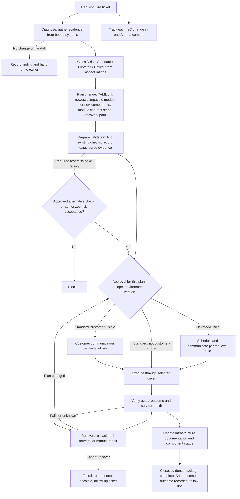

# DMVP-10650 — Delivery Platform Planning

Status: draft for planning review — not an approved design
Tracking: [DMVP-10650](https://tutorbot.atlassian.net/browse/DMVP-10650)
Definition: [Delivery platform vision](../requirements/delivery-platform-vision.md)
Inputs: [Planning-input register](../requirements/delivery-platform-planning-inputs.md)

## The plan in short

**Goal.** One standard path from "someone asks for an infrastructure change"
to "it is done, verified, and documented". AI does the routine work
(gathering facts, preparing the change, checking, record keeping); people
make the decisions. Small changes stay fast; risky ones get more care.

**What exists today.** This repository can bootstrap a customer copy and make
a YAML change through Terraform Cloud, Terramate, or Terragrunt. Everything
around the change is missing: who approves, how the customer is told, how we
prove it worked, how documentation is updated, how we learn that a module
upgrade is due, and what happens when a change fails halfway.

**How a change will flow** (example: an EKS module upgrade):

1. **Ticket and change record** — every change starts as a Jira ticket.
   Create an Announcement for an IaC change once the ticket is prioritized
   and there is a usable expected window, even if the window is tentative.
2. **Look first** — AI gathers facts: what is deployed, versions, health.
   The answer may be "no change needed" or "hand off to another team".
3. **Rate the risk** — one risk model: Standard, Elevated, or Critical,
   decided with a rating per aspect (availability, performance, security,
   cost, data). Each level has fixed requirements for approval, customer
   communication, validation, and evidence.
4. **Plan** — YAML edits, steps, and recovery. New components use the newest
   compatible module release, not a version copied from an older setup. For
   module upgrades, use the module maintainers' tested guidance for the
   applicable versions and assess it against the target environment.
5. **Decide how to prove it worked** — find existing tests/checks. If a
   required test is missing or fails, the change needs an approved
   alternative check or explicit authorized risk acceptance; otherwise it is
   blocked.
6. **Approve and communicate** — apply the approval and customer
   communication rules for the risk level. Record applicable internal and
   customer communications in the Announcement linked to the ticket.
7. **Run** through the customer's selected tool.
8. **Check the service really works**, not only that the apply succeeded. If
   it does not: roll back, roll forward, or repair, with escalation and
   reapproval when the plan changes. A change can end as failed; that state
   is recorded, not hidden.
9. **Update the Announcement with the verified outcome**, update the
   customer's infrastructure documentation and component status, then close.

Every change leaves an **evidence package**: Jira is the index and links to
the real evidence (approved plan, approver, PR, run and identity, test
results, health check, documentation update, remaining risks). A comment such
as "tests passed" is not evidence on its own.

**Incidents.** Investigation and authorized containment start immediately.
Any production change still needs a human approval (a named backup approver
covers absence) and a minimum incident record before it runs; the rest of the
evidence is completed afterwards.

**Module side.** Module releases that need consumer action ship a change
contract. Each customer copy compares the module versions pinned in its YAML
with released versions and opens a ticket when an upgrade applies. Missing
module features found during delivery become sanitized issues on the module
repository, then a release, then voluntary adoption.

**Getting changes into customer repositories.** Most customer
infrastructure repositories already started from this boilerplate. When
boilerplate changes are released, a **sync prompt** lets any operator's AI
assistant update a customer repository: it pulls only the boilerplate-owned
files (skills, runbooks, schemas, CI, instructions), never overwrites
customer-owned YAML or configuration, proposes any needed customer-file edits
from release migration notes, and delivers everything as a reviewed PR. Older
repositories without a recorded version are onboarded through bootstrap
first. Sync is a controlled workstream with immutable releases, conflict
handling, and rollback.

**Works with Codex, Claude Code, and Cursor.** `AGENTS.md` stays the single
source of instructions; each tool's own entry file only points to it, and the
same skills are exposed to all three. Each tool is validated separately for
data handling, logging, and security before customer use.

**Order of work.**

1. **Measure today** — how long a small change, a big change, and an incident
   take now.
2. **Batch 1: write the rules** — the flow above, the risk model, approvals,
   the evidence package, what customer data AI may send to a model, the
   validation and recovery rules, the documentation step, the module change
   contract, plus the boilerplate sync prompt and the Codex/Claude Code/Cursor
   setup that carry these rules into customer repositories. Rules and skills,
   not yet enforced.
3. **Trial (PoC)** — three cases: a small non-production change, a big
   production change, and an incident. Each trial has named owners,
   thresholds, and stop conditions. No new AI production access is introduced
   before the access controls are enforced. Compare with today; a named
   decision-maker decides to adopt, revise, or test further.
4. **Batch 2: automate and enforce** — limited-rights AI access, the Jira and
   CloudBrowser link, the version-check job, and safely resuming a
   half-finished change.

**Handled elsewhere.** DMVP-10788 owns the reusable MSP documentation package,
templates, evidence mapping, and documentation gaps. Full MSP readiness
(validation matrix, technical controls, operational evidence, customer
samples, demonstrations, audit readiness) is a separate workstream with its
own owner. The repository licence and public/private decision needs a named
business owner, and licence approval gates distribution to customers.

The sections below hold the detail behind this summary.

## Purpose

The Definition is agreed. This document is the working packet for the
planning stage: current-state assessment, gap register, proposed workflow,
dispositions of PLN-01 to PLN-14, the required PoC plan, and the proposed
implementation batches. Each section is a proposal until the delivery team
and reviewers record agreement in the PR or ticket.

Customer names, customer-specific scenarios, and PoC evidence stay in Jira and
other authorized systems. This repository is public.

## Planning sequence

| Step | Output (ticket output #) | Owner | Depends on |
| --- | --- | --- | --- |
| P1 | Current-state assessment and gap register (2) | Delivery foundation developer | — |
| P2 | Proposed workflow, variants, and record roles (1) | Delivery foundation developer, Delivery Team Lead | P1 |
| P3 | PLN-01 to PLN-14 dispositions with owners and linked tickets | Item owners below | P1, P2 |
| P4 | PoC plan for three paths, baseline, acceptance thresholds (7) | Delivery foundation developer (PoC lead) | P2 |
| P5 | Implementation order, first batch, later batches, tickets (3, 4) | Delivery foundation developer, delivery team | P3, P4 |
| P6 | Stakeholder review packet and coverage assessment (5) | Feedback coordination owner (to name) | P2–P5 |
| P7 | Repository access/distribution decision (6) | Business owner (to name), legal input | Independent |

P6 starts only when a complete packet exists; the ten-working-day window
starts on the recorded share date. P7 can run in parallel; it needs a named
business owner before any technical assessment is useful.

## P1 — Current-state assessment

Assessed against main at `353b3f3` (PR #9 merged), refreshed on 2026-11-19
against the default branches of infra-governance (`861836e`) and the
operations repository (`f25570d`), and updated on 2026-11-25 for the two
merged PoC inputs below (boilerplate `d3f25d6`, infra-governance `3b69fdc`). "Exists" means present in the repository
today, not proven in customer use. Reuse these existing skills and workflows
instead of building parallel versions.

| Area | Exists today | Evidence |
| --- | --- | --- |
| Repository role and boundaries | Tenant-neutral template, fork ownership, generated-output rules, approval-required scopes | `AGENTS.md`, `docs/runbooks/template-fork-contract.md` |
| Customer context | Nine management planes with `bound`/`read-only`/`planned`/`not-applicable`/`gap` status and overall readiness | `config/customer-context.yaml`, `schemas/customer-context.schema.json` |
| Bootstrap | Read-only discovery, proposal with immutable token, explicit confirmation, in-place population | `skills/infrastructure-bootstrap/SKILL.md`, `scripts/bootstrap/` |
| Bounded execution | YAML-first change flow, readiness stop rules, driver routing, completion report | `skills/infra-execution/SKILL.md` |
| Drivers | Terraform Cloud (default), Terramate, Terragrunt runbooks | `metacloud.yaml`, `docs/runbooks/` |
| Module policy | DasMeta-preferred; alternatives need immutable version, provenance, owner, review, reason | `config/standards-binding.yaml` |
| CI | Template contract validation on GitHub, GitLab, Bitbucket; GitLab keeps a default-branch `apply` job | `.github/workflows/`, `.gitlab-ci.yml`, `bitbucket-pipelines.yml` |
| Change planning | Interview-based plan with Standard/Elevated/Critical rigor tiers and Ready/Not Ready state | infra-governance `change-delivery-planner` |
| Module upgrade guidance | Per-module guides exist for some modules (for example the EKS stability guide); no common contract | module repositories |
| Delivery bindings lookup | Bootstrap discovers scoped customer delivery bindings and validates them against a delivery capability schema (boilerplate PR #12) | `scripts/bootstrap/delivery-bindings.rb`, `schemas/delivery-capability.schema.json` |
| Read-only diagnosis | Provider-neutral diagnostic skill (infra-governance PR #101, merged); not yet adopted by the DasMeta IaC consumer repository | infra-governance |
| Change review | `change-reviewer` skill for reviewing pull requests and local changes | infra-governance |
| Maintenance communication | Merged skill for drafting maintenance messages; existing onboarding, reconciliation, and publishing workflows | operations repository |
| CloudBrowser AI context | Product context, MCP guidance, and client skills planned under DEV-2352 (not yet delivered) | DEV-2352 |
| Template/fork file ownership | Upstream-owned versus fork-owned files and an adoption contract that forbids overwriting fork-owned context | `docs/runbooks/template-fork-contract.md` |
| AI assistant entry points | `AGENTS.md` (read by Codex and Cursor); skills exposed through `.agents/skills` | `AGENTS.md`, `.agents/skills` |

Not present today: a defined end-to-end delivery workflow, change records
linked to Jira and CloudBrowser Announcements, a component register with
pinned versus available module versions, release-validation preparation,
documentation-maintenance triggers, agent identity and elevation model,
durable resumable workflow state, baseline measurements, a licence,
boilerplate releases with a recorded synced version per customer repository,
a repeatable sync procedure, and Claude Code / Cursor entry points.

## P1 — Gap register

Each gap links to the Definition outcome it blocks and the planning input that
carries the detailed design. "Batch" is the proposed batch from P5.

| Gap | Outcome | Input | Current state | Proposed batch |
| --- | --- | --- | --- | --- |
| G-01 No defined workflow stages, variants, or entry/exit criteria | DEL-01, DEL-06 | PLN-01 | Skills cover bootstrap and execution steps only | B1 |
| G-02 Approval is a binding placeholder; no scope/version-bound approval record | DEL-07 | PLN-02 | `change_delivery` plane `planned`; approvals listed by scope only | B1 |
| G-03 No agent identity, least-privilege credential, or elevation model | DEL-02, DEL-07 | PLN-03 | GitLab `apply` uses long-lived CI variables | B1 (design), B2 (enforce) |
| G-04 No rule for which customer data may be sent to a model | DEL-04, DEL-11 | PLN-04 | Secrets excluded from Git only | B1 |
| G-05 No durable, resumable workflow state; partial/unknown outcomes not modelled | DEL-06, DEL-12 | PLN-05 | Completion report only | B1 (outcome states), B2 (resumable state) |
| G-06 Service verification beyond a successful apply is not defined | DEL-06, DEL-10 | PLN-06 | `operational_assurance` plane `planned` | B1 (with G-12) |
| G-07 No baseline for operator effort, waiting, or delivery time | DEL-05 | PLN-11 | None | B0 |
| G-08 Module-gap intake and upstream route undefined | DEL-01, DEL-04 | PLN-08 | Routing rule only ("route to owning repository") | B2 |
| G-09 No module change contract; upgrades depend on per-module prose | DEL-08, DEL-09 | PLN-09 | Version pins in YAML; guides vary by module | B1 (contract), B2 (check job) |
| G-10 MSP documentation package and full MSP readiness not mapped | DEF-05 | PLN-10 | Documentation package tracked under DMVP-10788; full readiness has no owner yet | Parallel |
| G-11 Infrastructure documentation not maintained by delivery | DEL-13 | PLN-13 | `knowledge_evidence` plane `planned` | B1 |
| G-12 No release-validation preparation step | DEL-14 | PLN-14 | Not present | B1 |
| G-13 No consistent change history linked to Jira delivery tickets | DEL-07, DEL-10 | PLN-02, PLN-06, [DMVP-11096](https://tutorbot.atlassian.net/browse/DMVP-11096) | CB Announcements exist; approval controls unverified (DEV-411, DEV-2210, DEV-2211) | B1 (change-tracking basis and current capability review), B2 (integration) |
| G-14 No process ownership, review cadence, or feedback route | DEL-08 | PLN-12 | None | B1 |
| G-15 Repository has no licence; access decision open | — | Ticket output 6 | Public, forked, unlicensed | P7 |
| G-16 No boilerplate releases, recorded synced version, or sync procedure; existing customer repositories cannot reliably adopt changes | DEL-02, DEL-08, DEL-09 | PLN-09 | Ownership split defined; no versions, migration notes, or sync prompt | B1 (prompt), B2 (lag reporting) |
| G-17 Instructions and skills reach Codex only by convention; no Claude Code or Cursor entry points | DEL-03 | PLN-07 | `AGENTS.md` and `.agents/skills` only | B1 |
| G-18 New components can be added with outdated module versions, creating immediate upgrade work | DEL-01, DEL-09 | PLN-09 | Module policy prefers DasMeta modules but says nothing about which version | B1 |
| G-19 No single risk model with per-level requirements; aspect impact (availability, performance, security, cost, data) not visible | DEL-06 | PLN-01, PLN-06 | `change-delivery-planner` tiers only | B1 |
| G-20 No defined evidence package per change | DEL-10 | PLN-06 | Completion report only | B1 |
| G-21 No responsibility model or separation of duties across delivery, account management, support, and MSP | DEL-07, DEL-08 | PLN-02, PLN-12 | Not defined | B1 |
| G-22 Shared skills are not portable: `change-delivery-planner` contains machine-specific absolute paths, and the upstream execution skill references an older template layout; this repository's execution skill is intentionally adapted | DEL-03, DEL-08 | PLN-07 | Reuse needs reviewed compatibility, not wholesale replacement | B1 |

## P2 — Proposed workflow

Every request starts from a Jira ticket. Every IaC change in the delivery
workflow gets an Announcement linked to that ticket. The risk level sets the
required controls and customer communication.

### Change tracking and announcements (G-13)

Use one published Announcement as the operational history for each change
carried out through an IaC repository, including changes that need no customer
notice. Create it when the work ticket is prioritized and the expected window
is specific enough to plan around. An agreed window can follow a tentative
one. Record publication is a technical state. Sending internal or customer
messages follows the communication workflow.

Each stage or skill contributes its update to the same record. Keep the
planned and actual timing, postponements or cancellations, applicable
customer agreements and execution approvals, internal and customer
communications, and the verified outcome. Preserve failed, partial, and
rolled-back attempts. Keep execution and communication status visible
independently, and link the ticket, IaC PR or revision, run, and verification
evidence for future diagnostics and audits.

Module maintainers test reusable changes and publish guidance for the release
or upgrade path, including change size, maintenance risk, impact, and
recommended windows where available. A Solution can combine guidance across
modules. The assigned IaC repository owner brings those changes into the
target environment, assesses the guidance locally, and records the chosen
window, approvals, execution evidence, and any deviations. Link the upstream
guidance from the Announcement.

Use the existing [Maintenance Checklist](https://tutorbot.atlassian.net/wiki/spaces/DO/pages/3987931138/Maintenance+Checklist)
and [Maintenance Message Template](https://tutorbot.atlassian.net/wiki/spaces/DO/pages/3987800085/Maintenance+Message+Template)
as references. DMVP-11096 tracks this basis and the related Confluence
workflows. Detailed stage fields, triggers, approval and communication flows,
and the structure of upstream guidance are follow-up work.

### Incident variant

- Investigation and authorized containment that does not change production
  start immediately.
- Any production change needs human authorization before it runs. When the
  primary approver is unavailable, a named backup approver decides (PLN-02).
- A minimum incident record exists before the production change: ticket,
  affected service and environment, proposed action, approver, and time.
- The rest of the evidence package is completed afterwards, within a time set
  in B1, and checked at incident review.

### One risk model (G-19)

The plan uses one set of levels: the infra-governance `change-delivery-planner`
tiers **Standard**, **Elevated**, and **Critical**. Aspect ratings are inputs
to that level, not a second model.

**Aspect ratings.** Every plan rates each aspect `None`, `Low`, `Medium`, or
`High` with a one-line reason:

| Aspect | What is assessed | Preparation when Medium or High |
| --- | --- | --- |
| Availability | Downtime, restarts, failover, blast radius | Maintenance window, announcement, rollback trigger |
| Performance | Latency, throughput, capacity, scaling behaviour | Before/after metrics and the dashboards to watch |
| Security | Access, exposure, IAM, secrets, network paths | Security review of the diff; access checked after the change |
| Cost | Expected monthly cost change, new billable resources | Cost estimate in the plan; customer informed when material |
| Data | Loss, integrity, migration, backup/restore needs | Backup or snapshot before change; restore path confirmed |

**Level criteria.** Standard: no aspect above `Low`, and either the change is
non-production, or it is production with an easy, tested rollback. Elevated:
any aspect `Medium`, or a production change that does not meet every Standard
condition. Critical: any aspect `High`, a hard or slow rollback, or
broad or unclear blast radius. When in doubt, choose the stricter level.

**What each level requires.**

| Level | Approval | Customer communication | Validation | Evidence |
| --- | --- | --- | --- | --- |
| Standard | Reviewer approves the PR | None, unless customer-visible | Existing checks or a recorded alternative | Core evidence package |
| Elevated | Named approver for this plan and version, separate from the executor | Customer notice before and after, recorded in the Announcement | Agreed checks for every Medium aspect; rollback trigger defined | Core package plus aspect evidence |
| Critical | Named approver plus requirement-owner or customer agreement as bound; separate executor | Customer notice with window, impact, and acknowledgement where required | Pre-production run where possible; checks for every Medium/High aspect; stop conditions | Full package plus recovery rehearsal or justification |

The aspect list and criteria are reviewed with delivery and support during B1;
aspects can be added (for example compliance) without changing the format.

### Validation rule (G-12)

When a required test or check is missing or fails, exactly one of these
applies before execution:

1. An **approved alternative validation** (who approved it and what it checks
   is recorded), or
2. **Explicit risk acceptance** by someone authorized for that risk level, or
3. The change is **blocked**.

Silence, a missing response, or "deployed successfully" never counts as
validation.

### Recovery outcomes (G-05)

| Outcome | Meaning | Required next step |
| --- | --- | --- |
| Rolled back | Previous state restored and verified | Record cause; replan or close as not delivered |
| Rolled forward | Fix applied on top of the change | Fix needs the same approval level if the plan changed materially |
| Manually repaired | Fixed outside IaC | Reconcile IaC with actual state; record the drift |
| Partial or unknown | Not clear what was applied | Stop further changes; establish actual state from provider and IaC run evidence before any retry |
| Escalated | Beyond the executor's authority or skill | Named escalation owner; reapproval before new production changes |
| Failed | Cannot be recovered within the window | Terminal state recorded with impact; follow-up ticket; customer informed per level |

### Evidence package per change (G-20)

Jira is the index. It links to the real evidence; it does not replace it.

| Evidence | Source |
| --- | --- |
| Approved plan, risk level, aspect ratings | Plan document or ticket section |
| Approver identity, decision, and time | Jira approval record |
| Operational change history, communications, and acknowledgement where required | Announcement linked to the delivery ticket |
| PR and commit | Git |
| Execution run and executing identity | IaC platform run |
| Test and check results | CI, test system, or recorded manual check with output |
| Service-health verification | Monitoring links or recorded queries |
| Recovery result, if any | Run evidence and recovery outcome above |
| Documentation update | Link to the updated customer documentation |
| Remaining risks and follow-ups | Linked tickets |

### Record roles

| Record | Owns | Does not own |
| --- | --- | --- |
| Jira delivery ticket | Work ownership, plan, approval decision with identity and time, evidence index | Customer-facing schedule text |
| CloudBrowser Announcement | Operational change history, planned and actual timing, outcome, communications, and evidence links | Approval authority, IaC run evidence, or service-health verification |
| Git PR in the customer fork | Declared intent diff and code review | Execution result |
| IaC platform run | Plan, apply, state, run evidence | Service health |
| Customer documentation location (bound in `knowledge_evidence`) | Current infrastructure documentation | Change history |

### Responsibilities (G-21)

Roles, not people. Names are agreed in the planning review and recorded in
Jira. One person may hold several roles, but the executor of a change is never
its only approver at Elevated or Critical level.

| Area | Responsible role |
| --- | --- |
| Customer impact, communication, consent | Account / Project Management |
| PoC customer selection | Account / Project Management |
| AWS opportunity and project linkage, expected value, adoption, case-study permission | Account / Project Management |
| IaC adoption and change record | IaC repository owner, usually a delivery manager or an assigned developer or support owner |
| Technical plan and execution | Delivery engineer (executor) |
| Change approval | Named approver per risk level, separate from executor |
| MSP validation | MSP-readiness owner |
| Support verification of service health | Support Team Lead or on-call |
| Documentation review | Documentation reviewer named per customer |
| AI and customer-data rules | AI/data owner |
| Workflow, skills, boilerplate | Delivery foundation developer |
| Module changes, tested release guidance, and contracts | Module maintainers |

## P3 — Planning-input dispositions

All dispositions are proposed. "Owner" is the role that records the final
disposition.

| Input | Proposed disposition | Owner | Notes |
| --- | --- | --- | --- |
| PLN-01 Workflow and routing | Incorporate in B1 | Delivery foundation developer | P2 above is the draft |
| PLN-02 Authority and approval | Incorporate in B1 | Delivery Team Lead | Per-level approval, backup approver, separation of duties, CB record roles |
| PLN-03 Enforceable boundaries | Incorporate: design B1, enforce B2 | Delivery foundation developer | Agent credential model first, per developer review |
| PLN-04 Customer data and AI safety | Incorporate in B1 | AI/data owner, security owner | New `ai_processing` binding in customer context |
| PLN-05 Continuity and recovery | Incorporate: outcome states B1, resumable state B2 | Support Team Lead | Recovery outcomes above |
| PLN-06 Service outcomes | Incorporate in B1 | Support Team Lead | Joined with PLN-14; evidence package |
| PLN-07 Operator experience | Incorporate across batches; measured in PoC | Delivery Team Lead | |
| PLN-08 Upstream module cooperation | Incorporate in B2 | Module development | See below |
| PLN-09 Module and version compatibility | Incorporate: contract B1, check job B2 | Module development | See below |
| PLN-10 MSP applicability and evidence | Route: documentation package to DMVP-10788; full MSP readiness to its own workstream | Account Manager (MSP), MSP-readiness owner | Not implemented by this repository |
| PLN-11 Measurement | Incorporate in B0 | Baseline owner | Baseline before B1 |
| PLN-12 Ongoing ownership | Incorporate in B1 | Delivery foundation developer | Responsibilities table above |
| PLN-13 Documentation maintenance | Incorporate in B1 | Delivery foundation developer | |
| PLN-14 Release validation | Incorporate in B1 | Delivery foundation developer, Delivery Team Lead | Validation rule above |

### PLN-09 — module change contract (module development)

Each module release that needs consumer action publishes a machine-readable
change contract next to its changelog, for example `docs/changes/vX.Y.Z.yaml`:

- `from` and `to` version range
- breaking changes and changed defaults
- required YAML edits for consumers
- prerequisites: Terraform and provider floors, related module versions
- ordered steps, including `moved` blocks or state operations
- pre-assessment checks and post-upgrade verification checks
- rollback path and points of no return
- known issues

The boilerplate gains a component register built from fork YAML (`source`,
`version` per component) and a status record per component: current version,
latest available, applicable contracts, last verified date. A scheduled check
compares pinned versions with releases and opens a Jira ticket when a contract
applies. Each upgrade then follows the P2 workflow, with the contract feeding
the plan, validation, and documentation steps.

Worked example: EKS module 2.x to 3.x, using the existing EKS stability guide
as the first contract source.

Prerequisites to verify in the module repositories before B1: breaking-change
commits are labelled and produce a major release; tags are protected;
native tests exist where release gates depend on them.

### PLN-08 — upstream module cooperation (module development)

Route: gap found in delivery → sanitized issue on the module repository (no
customer data) → triage by module owner → change and release with contract →
voluntary adoption in forks through the check job. Triage owner and expected
turnaround are set in B2.

### Boilerplate sync to customer repositories (G-16)

Most customer infrastructure repositories already started from this
boilerplate, so new workflow rules reach them only through a repeatable sync.
This is a controlled workstream with its own tickets.

- **Releases.** Tag immutable boilerplate releases with a changelog. Each
  customer repository records the boilerplate version it last synced from.
- **Sync prompt.** A released, assistant-neutral prompt at a fixed path (for
  example `docs/runbooks/boilerplate-sync.md`) that operators run against each
  customer repository. It reads the recorded version and the changelog since
  that version.
- **What it may change.** Uses the ownership split in the template/fork
  contract. Boilerplate-owned files (skills, schemas, scripts, tests,
  runbooks, CI adapters, assistant instructions) are updated. Customer-owned
  files (`WORKSPACE.md`, `config/*`, `metacloud.yaml`, `0-accounts/`,
  `1-environments/`, `2-products/`) are never overwritten.
- **Migration notes.** When a release needs customer-owned edits (for example
  a new context field), it ships a migration note in the same format as the
  module change contract. The prompt proposes those edits as a diff for human
  approval.
- **Compatibility and conflicts.** If a boilerplate-owned file was changed
  locally in the customer repository, the prompt stops on that file and shows
  the conflict instead of overwriting it.
- **Rollback.** A sync is one PR; reverting it restores the previous recorded
  version.
- **Provenance and security.** The prompt pulls only from a tagged release of
  this repository, records the release and commit in the PR, and never copies
  secrets or customer data in either direction.
- **First sync.** A repository with no recorded version or an older layout is
  onboarded through the bootstrap skill instead of a file sync.
- **Output.** Always a PR in the customer repository with template tests and
  `meta validate-yaml` passing. No generated output is edited and nothing is
  applied; a person reviews and merges.
- **Visibility.** In B2 the version-check job reports boilerplate version lag
  per customer repository, only where the customer has agreed to this
  reporting.
- **Licence gate.** Design and internal use can continue, but distribution to
  customers waits for the licence decision (P7).

### Module version for new components (G-18)

When a change adds something new (a component, environment, or service)
rather than changing an existing setup, the assistant selects the newest
released version of the module at planning time. It does not copy a version
from another environment, an example, or an older customer setup.

- **Compatibility first.** If the newest release needs Terraform, provider, or
  related-module versions the customer repository does not meet (from the
  module's change contract or release notes), use the newest compatible
  release, or plan the prerequisite upgrade. Record the reason in the plan.
- **Customer exceptions.** A customer standards binding may pin a version or
  range; the assistant follows it and states that a newer release exists.
- **Where it lives.** A `new_component_version` rule (default `latest-compatible`)
  in the standards-binding module policy, enforced by the `infra-execution`
  skill. The B2 version-check job then keeps existing components visible.

### Assistant support: Codex, Claude Code, Cursor (G-17)

`AGENTS.md` remains the single source of repository instructions. Each
supported tool gets only a thin entry point that refers to it:

| Tool | Instructions | Skills |
| --- | --- | --- |
| Codex | `AGENTS.md` (native) | `.agents/skills` → `skills/` (exists) |
| Claude Code | `CLAUDE.md` importing `@AGENTS.md` | `.claude/skills` → `skills/` |
| Cursor | `AGENTS.md`; `.cursor/rules` entry referring to it if needed | Verify Cursor's skill discovery path before choosing |

Skills keep the shared `SKILL.md` format. Repository text that names a single
assistant is generalised to "the configured assistant".

Each tool is a separately validated workstream before customer use:

- **Compatibility** — the same skills and instructions load and behave the
  same way.
- **Instruction precedence** — how the tool combines `AGENTS.md`, its own
  entry file, and user or global settings, so repository rules are not
  silently overridden.
- **Data, provider, and region** — where prompts and repository content are
  processed, checked against the customer's `ai_processing` binding (PLN-04).
- **Logging and retention** — what the tool stores locally and remotely, and
  for how long.
- **Security** — credentials the tool can reach and what it may execute.

The PoC runs at least one path with an assistant other than Codex.

### Boundary with related tickets

- **DEV-2352** owns CloudBrowser product context, MCP guidance, and client
  skills. Product semantics stay there; this plan binds them into delivery and
  does not copy them.
- **DEV-2356** plans the shared infrastructure-management foundation, the
  broader Support, SRE, and Delivery integration, and customer skill
  distribution without private source access or committed skill copies in
  delivery repositories. It consumes this workflow and its PoC and agrees
  interfaces with it. It does not take over the workflow implementation, and
  there is no blocking dependency between the two.
- Distribution of skills to customer repositories (part of G-17) therefore
  follows the DEV-2356 route; this plan owns only the repository entry points
  and the per-assistant validation above.

## P4 — PoC plan

Lead: delivery foundation developer. Detailed scenarios, customers, and
evidence are recorded in Jira, not here.

**Inputs and prerequisite.** Two reviewed inputs for the read-only workflow
PoC are merged: the bootstrap delivery-bindings lookup (boilerplate PR #12) and
the provider-neutral diagnostic skill (infra-governance PR #101). Consumer
adoption and the end-to-end pilot are still pending. Before the pilot, the
DasMeta IaC consumer repository must move from its older pinned governance
revision to one that includes these skills and declare them; the owner of that
step is to be named in Jira.

**Production safety.** The PoC introduces no new AI production permissions
before the credential, approval, audit, and access controls from B1/B2 are
enforced. Early trials use simulation, non-production environments, or
controls that are already approved; any production step runs under existing
human authority.

| Path | Example shape | Must demonstrate |
| --- | --- | --- |
| Routine low-risk change | Non-production module patch upgrade | Ticket to close with minimal operator steps; Announcement history even without a customer notice; validation prep including a missing test; evidence package; documentation update |
| Higher-risk production change | Production module major upgrade using a change contract | Elevated/Critical requirements; approval bound to plan and version; CB Maintenance announcement linked to ticket; validation and recovery readiness; post-change verification |
| Urgent incident | Production degradation needing an infrastructure fix | Fast investigation and containment; human authorization and minimum record before production change; backup approver path; fallback when AI or integrations are unavailable |

Each path is executable only when every field below is filled in Jira:

| Field | Routine | Higher-risk | Incident |
| --- | --- | --- | --- |
| Scenario-selection owner | to name | to name | to name |
| Environment / customer | to agree | to agree | to agree |
| Execution owner | to name | to name | to name |
| Approver | to name | to name | to name |
| Success metrics and thresholds | to agree | to agree | to agree |
| Stop conditions | to agree | to agree | to agree |
| Evidence reviewers | to name | to name | to name |
| Final decision-maker | to name | to name | to name |

Baseline for comparison: current practice for the same path (time, operator
steps, questions, approval waiting, handoffs), measured in B0. These answer
the delivery questions retained in the planning-input register.

## P5 — Proposed batches

| Batch | Outcome | Contents |
| --- | --- | --- |
| B0 | Baseline | Measure current practice for the three PoC paths (PLN-11) |
| B1 | Workflow and contracts on paper, usable in the PoC | Workflow and record roles; risk model with per-level requirements; approval record; evidence package; validation and recovery rules; responsibilities; AI data binding; credential model design; documentation maintenance; module change contract; boilerplate releases and sync prompt; Codex/Claude Code/Cursor entry points and validation; newest-compatible module rule for new components |
| PoC | Validate before enforcement | Three paths with filled execution fields, at least one with a non-Codex assistant, no new AI production access; adoption decision |
| B2 | Enforcement and automation | Credential enforcement; resumable state; CB/Jira integration; component register and check job including consented boilerplate version lag; module-gap route |
| B3+ | Later | Items deferred by P3 and PoC findings |

Version labels (v2, v3, ...) are assigned only after checking actual release
history, per the planning-input register.

## Owners and approvers

Roles are held by as few people as possible; none needs a separate person.

| Role | Held by |
| --- | --- |
| Implementation approvers (the people who use the delivery flow) | Delivery team: Delivery Team Lead and the delivery engineers |
| MSP and AWS integration owner; MSP-readiness (full readiness, separate from DMVP-10788); customer-communications owner | Account Manager (MSP) |
| Feedback coordination (P6), baseline owner and location (B0), AI/data owner (PLN-04), PoC lead | Delivery foundation developer |
| PoC final decision-maker | Delivery team, after reviewing the trial results (to confirm) |
| Business owner for the licence and access decision (P7) | Open; needed before customer distribution |

Record the named people in DMVP-10650.

Records:

- DMVP-10650 shows the Planning stage and links this PR.
- After the plan is agreed, implementation tickets for B0, B1, the PoC, and
  the sync and multi-assistant workstreams are created and linked to
  DMVP-10650.

## Implementation status

Updated as batches land. "Done" means present in this repository, not proven
in customer use.

| B1 item | Status | Where |
| --- | --- | --- |
| Workflow, record roles, risk model, validation and recovery rules, incident variant, evidence package | Done | `skills/delivery-workflow/SKILL.md` |
| Announcement change record (G-13) | Done (basis); stage updates in progress | Runbook "Delivery change tracking" (DMVP-11096); stage updates DMVP-11109 |
| Delivery bindings lookup | Done | `scripts/bootstrap/delivery-bindings.rb` |
| Responsibilities | Done | "Owners and approvers" above |
| Claude Code entry point | Done | `CLAUDE.md`, `.claude/skills` |
| Cursor entry point and per-assistant validation (G-17) | Open | — |
| Newest-compatible module rule (G-18) | Done in workflow skill; not yet in `standards-binding` | `skills/delivery-workflow/SKILL.md` |
| Approval record format (G-02) | Open | — |
| AI customer-data binding (G-04) | Open; workflow uses a minimum-data rule until bound | — |
| Credential model design (G-03) | Open | — |
| Documentation-maintenance triggers (G-11) | Partial: workflow step only | `skills/delivery-workflow/SKILL.md` |
| Module upgrade guidance (G-09) | Owned by module maintainers | Module repositories |
| Boilerplate releases and sync prompt (G-16) | Open | — |
| Shared skill portability (G-22) | Open | Infra Governance |
| Baseline (B0) | Open | — |
