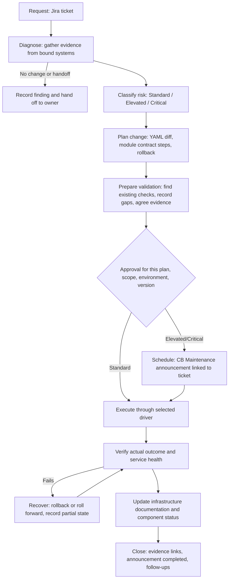

# DMVP-10650 — Delivery Platform Planning

Status: draft for planning review — not an approved design
Tracking: [DMVP-10650](https://tutorbot.atlassian.net/browse/DMVP-10650)
Definition: [Delivery platform vision](../requirements/delivery-platform-vision.md)
Inputs: [Planning-input register](../requirements/delivery-platform-planning-inputs.md)

## The plan in short

**Goal.** One standard path from "someone asks for an infrastructure change"
to "it is done, verified, and documented". AI does the routine work
(gathering facts, preparing the change, checking, record keeping); people
make the decisions. Small changes stay fast; risky ones get more care.

**What exists today.** This repository can bootstrap a customer copy and make
a YAML change through Terraform Cloud, Terramate, or Terragrunt. Everything
around the change is missing: who approves, how the customer is told, how we
prove it worked, how documentation is updated, how we learn that a module
upgrade is due, and what happens when a change fails halfway.

**How a change will flow** (example: an EKS module upgrade):

1. **Ticket** — every change starts as a Jira ticket.
2. **Look first** — AI gathers facts: what is deployed, versions, health.
   The answer may be "no change needed" or "hand off to another team".
3. **Rate the risk** — small, medium, or big; this sets how much process applies.
4. **Plan** — YAML edits, steps, rollback. For module upgrades, the module
   repository publishes a *change contract* saying exactly what to do
   between versions.
5. **Decide how to prove it worked** — find existing tests/checks; if none
   exist, say so and decide how to validate.
6. **Approve and announce** — for medium and big changes a person approves this
   specific plan, and the customer is informed through a CloudBrowser
   Maintenance announcement linked to the ticket.
7. **Run** through the customer's selected tool.
8. **Check the service really works**, not only that the apply succeeded;
   roll back if it does not.
9. **Update the customer's infrastructure documentation** and component
   status, then close.

Incidents take a shortcut: fix first, complete records afterwards. Production
changes still need a human approval, with a backup approver.

**Module side.** Module releases that need consumer action ship a change
contract. Each customer copy compares the module versions pinned in its YAML
with released versions and opens a ticket when an upgrade applies. Missing
module features found during delivery become sanitized issues on the module
repository, then a release, then voluntary adoption.

**Order of work.**

1. **Measure today** — how long a small change, a big change, and an incident
   take now.
2. **Batch 1: write the rules** — the flow above, approvals, what customer data
   AI may send to a model, the validation step, the documentation step, and
   the module change contract. Rules and skills, not yet enforced.
3. **Trial (PoC)** — three cases: a small non-production change, a big
   production change, and an incident. Compare with today; the team decides
   to adopt, revise, or test further.
4. **Batch 2: automate and enforce** — limited-rights AI access, the Jira and
   CloudBrowser link, the version-check job, and safely resuming a
   half-finished change.

**Handled elsewhere.** MSP documentation and evidence continue in DMVP-10788.
The repository licence and public/private decision needs a named business
owner.

The sections below hold the detail behind this summary.

## Purpose

The Definition is agreed. This document is the working packet for the
planning stage: current-state assessment, gap register, proposed workflow,
dispositions of PLN-01 to PLN-14, the required PoC plan, and the proposed
implementation batches. Each section is a proposal until the requirement owner
and reviewers record agreement in the PR or ticket.

Customer names, customer-specific scenarios, and PoC evidence stay in Jira and
other authorized systems. This repository is public.

## Planning sequence

| Step | Output (ticket output #) | Owner | Depends on |
| --- | --- | --- | --- |
| P1 | Current-state assessment and gap register (2) | Delivery foundation developer | — |
| P2 | Proposed workflow, variants, and record roles (1) | Delivery foundation developer, Delivery Team Lead | P1 |
| P3 | PLN-01 to PLN-14 dispositions with owners and linked tickets | Item owners below | P1, P2 |
| P4 | PoC plan for three paths, baseline, acceptance thresholds (7) | Delivery foundation developer (PoC lead) | P2 |
| P5 | Implementation order, first batch, later batches, tickets (3, 4) | Delivery foundation developer, requirement owner | P3, P4 |
| P6 | Stakeholder review packet and coverage assessment (5) | Feedback coordination owner (to name) | P2–P5 |
| P7 | Repository access/distribution decision (6) | Business owner (to name), legal input | Independent |

P6 starts only when a complete packet exists; the ten-working-day window
starts on the recorded share date. P7 can run in parallel; it needs a named
business owner before any technical assessment is useful.

## P1 — Current-state assessment

Assessed against main at `353b3f3` (PR #9 merged) and the infra-governance skills it
references. "Exists" means present in the repository today, not proven in
customer use.

| Area | Exists today | Evidence |
| --- | --- | --- |
| Repository role and boundaries | Tenant-neutral template, fork ownership, generated-output rules, approval-required scopes | `AGENTS.md`, `docs/runbooks/template-fork-contract.md` |
| Customer context | Nine management planes with `bound`/`read-only`/`planned`/`not-applicable`/`gap` status and overall readiness | `config/customer-context.yaml`, `schemas/customer-context.schema.json` |
| Bootstrap | Read-only discovery, proposal with immutable token, explicit confirmation, in-place population | `skills/infrastructure-bootstrap/SKILL.md`, `scripts/bootstrap/` |
| Bounded execution | YAML-first change flow, readiness stop rules, driver routing, completion report | `skills/infra-execution/SKILL.md` |
| Drivers | Terraform Cloud (default), Terramate, Terragrunt runbooks | `metacloud.yaml`, `docs/runbooks/` |
| Module policy | DasMeta-preferred; alternatives need immutable version, provenance, owner, review, reason | `config/standards-binding.yaml` |
| CI | Template contract validation on GitHub, GitLab, Bitbucket; GitLab keeps a default-branch `apply` job | `.github/workflows/`, `.gitlab-ci.yml`, `bitbucket-pipelines.yml` |
| Change planning | Interview-based plan with Standard/Elevated/Critical rigor tiers and Ready/Not Ready state | infra-governance `change-delivery-planner` |
| Module upgrade guidance | Per-module guides exist for some modules (for example the EKS stability guide); no common contract | module repositories |

Not present today: a defined end-to-end delivery workflow, change records
linked to Jira and CloudBrowser Announcements, a component register with
pinned versus available module versions, release-validation preparation,
documentation-maintenance triggers, agent identity and elevation model,
durable resumable workflow state, baseline measurements, and a licence.

## P1 — Gap register

Each gap links to the Definition outcome it blocks and the planning input that
carries the detailed design. "Batch" is the proposed batch from P5.

| Gap | Outcome | Input | Current state | Proposed batch |
| --- | --- | --- | --- | --- |
| G-01 No defined workflow stages, variants, or entry/exit criteria | DEL-01, DEL-06 | PLN-01 | Skills cover bootstrap and execution steps only | B1 |
| G-02 Approval is a binding placeholder; no scope/version-bound approval record | DEL-07 | PLN-02 | `change_delivery` plane `planned`; approvals listed by scope only | B1 |
| G-03 No agent identity, least-privilege credential, or elevation model | DEL-02, DEL-07 | PLN-03 | GitLab `apply` uses long-lived CI variables | B1 (design), B2 (enforce) |
| G-04 No rule for which customer data may be sent to a model | DEL-04, DEL-11 | PLN-04 | Secrets excluded from Git only | B1 |
| G-05 No durable, resumable workflow state; partial/unknown outcomes not modelled | DEL-06, DEL-12 | PLN-05 | Completion report only | B2 |
| G-06 Service verification beyond a successful apply is not defined | DEL-06, DEL-10 | PLN-06 | `operational_assurance` plane `planned` | B1 (with G-12) |
| G-07 No baseline for operator effort, waiting, or delivery time | DEL-05 | PLN-11 | None | B0 |
| G-08 Module-gap intake and upstream route undefined | DEL-01, DEL-04 | PLN-08 | Routing rule only ("route to owning repository") | B2 |
| G-09 No module change contract; upgrades depend on per-module prose | DEL-08, DEL-09 | PLN-09 | Version pins in YAML; guides vary by module | B1 (contract), B2 (check job) |
| G-10 MSP applicability and evidence not mapped | DEF-05 | PLN-10 | Tracked under DMVP-10788 for documentation | Parallel |
| G-11 Infrastructure documentation not maintained by delivery | DEL-13 | PLN-13 | `knowledge_evidence` plane `planned` | B1 |
| G-12 No release-validation preparation step | DEL-14 | PLN-14 | Not present | B1 |
| G-13 No link between Jira delivery tickets and CloudBrowser Announcements | DEL-07, DEL-10 | PLN-02, PLN-06 | CB Announcements exist; approval controls unverified (DEV-411, DEV-2210, DEV-2211) | B1 (roles), B2 (integration) |
| G-14 No process ownership, review cadence, or feedback route | DEL-08 | PLN-12 | None | B1 |
| G-15 Repository has no licence; access decision open | — | Ticket output 6 | Public, forked, unlicensed | P7 |

## P2 — Proposed workflow

One flow with three risk variants. Every request starts from a Jira ticket.
Planned changes that affect customers also get a CloudBrowser Maintenance
announcement linked to that ticket.

Incident variant: diagnosis and mitigation can start before the ticket is
complete; human approval for production mutation still applies, through a
named backup approver when the primary is unavailable (PLN-02 proposal).
Records are completed afterwards.

### Record roles

| Record | Owns | Does not own |
| --- | --- | --- |
| Jira delivery ticket | Work ownership, plan, approval decision with identity and time, execution and validation evidence links | Customer-facing schedule text |
| CloudBrowser Maintenance announcement | Customer-facing schedule, window, impact, communications, link to ticket | Approval authority; a status of Scheduled or Completed is not approval or validation |
| Git PR in the customer fork | Declared intent diff and code review | Execution result |
| IaC platform run | Plan, apply, state, run evidence | Service health |
| Customer documentation location (bound in `knowledge_evidence`) | Current infrastructure documentation | Change history |

## P3 — Planning-input dispositions

All dispositions are proposed. "Owner" is the role that records the final
disposition.

| Input | Proposed disposition | Owner | Notes |
| --- | --- | --- | --- |
| PLN-01 Workflow and routing | Incorporate in B1 | Delivery foundation developer | P2 above is the draft |
| PLN-02 Authority and approval | Incorporate in B1 | Requirement owner, Delivery Team Lead | Includes backup approver proposal and CB record roles |
| PLN-03 Enforceable boundaries | Incorporate: design B1, enforce B2 | Delivery foundation developer | Agent credential model first, per developer review |
| PLN-04 Customer data and AI safety | Incorporate in B1 | Delivery foundation developer, security owner | New `ai_processing` binding in customer context |
| PLN-05 Continuity and recovery | Incorporate in B2 | Support Team Lead | Depends on B1 workflow state |
| PLN-06 Service outcomes | Incorporate in B1 | Support Team Lead | Joined with PLN-14 |
| PLN-07 Operator experience | Incorporate across batches; measured in PoC | Delivery Team Lead | |
| PLN-08 Upstream module cooperation | Incorporate in B2 | Module development (Tigran) | See below |
| PLN-09 Module and version compatibility | Incorporate: contract B1, check job B2 | Module development (Tigran) | See below |
| PLN-10 MSP applicability and evidence | Route to DMVP-10788 and MSP owner | Account Manager (MSP) | Not implemented by this repository |
| PLN-11 Measurement | Incorporate in B0 | Delivery foundation developer | Baseline before B1 |
| PLN-12 Ongoing ownership | Incorporate in B1 | Requirement owner | |
| PLN-13 Documentation maintenance | Incorporate in B1 | Delivery foundation developer | |
| PLN-14 Release validation | Incorporate in B1 | Delivery foundation developer, Delivery Team Lead | |

### PLN-09 — module change contract (module development)

Each module release that needs consumer action publishes a machine-readable
change contract next to its changelog, for example `docs/changes/vX.Y.Z.yaml`:

- `from` and `to` version range
- breaking changes and changed defaults
- required YAML edits for consumers
- prerequisites: Terraform and provider floors, related module versions
- ordered steps, including `moved` blocks or state operations
- pre-assessment checks and post-upgrade verification checks
- rollback path and points of no return
- known issues

The boilerplate gains a component register built from fork YAML (`source`,
`version` per component) and a status record per component: current version,
latest available, applicable contracts, last verified date. A scheduled check
compares pinned versions with releases and opens a Jira ticket when a contract
applies. Each upgrade then follows the P2 workflow, with the contract feeding
the plan, validation, and documentation steps.

Worked example: EKS module 2.x to 3.x, using the existing EKS stability guide
as the first contract source.

Prerequisites to verify in the module repositories before B1: breaking-change
commits are labelled and produce a major release; tags are protected;
native tests exist where release gates depend on them.

### PLN-08 — upstream module cooperation (module development)

Route: gap found in delivery → sanitized issue on the module repository (no
customer data) → triage by module owner → change and release with contract →
voluntary adoption in forks through the check job. Triage owner and expected
turnaround are set in B2.

## P4 — PoC plan outline

Lead: delivery foundation developer. Detailed scenarios, customers, and
evidence are recorded in Jira, not here.

| Path | Example shape | Must demonstrate |
| --- | --- | --- |
| Routine low-risk change | Non-production module patch upgrade | Ticket to close with minimal operator steps; validation prep including missing test coverage; documentation update |
| Higher-risk production change | Production module major upgrade using a change contract | Approval bound to plan and version; CB Maintenance announcement linked to ticket; validation and rollback readiness; post-change verification |
| Urgent incident | Production degradation needing an infrastructure fix | Fast diagnosis; backup approver path; fallback when AI or integrations are unavailable; records completed afterwards |

Before execution, record for each path: baseline from current practice (time,
operator steps, questions, approval waiting, handoffs), adoption thresholds,
safe environment or simulation, execution authority, reviewers, and the
adopt / revise / validate-further decision owner. These answer the delivery
questions retained in the planning-input register.

## P5 — Proposed batches

| Batch | Outcome | Contents |
| --- | --- | --- |
| B0 | Baseline | Measure current practice for the three PoC paths (PLN-11) |
| B1 | Workflow and contracts on paper, usable in the PoC | Workflow and record roles; approval record; AI data binding; credential model design; validation prep; documentation maintenance; module change contract; ownership |
| PoC | Validate before enforcement | Three paths; adoption decision |
| B2 | Enforcement and automation | Credential enforcement; resumable state; CB/Jira integration; component register and check job; module-gap route |
| B3+ | Later | Items deferred by P3 and PoC findings |

Version labels (v2, v3, ...) are assigned only after checking actual release
history, per the planning-input register.

## Open decisions

- Feedback coordination owner for P6.
- Business owner for the access/licence decision (P7).
- Where the PoC baseline data is recorded.
